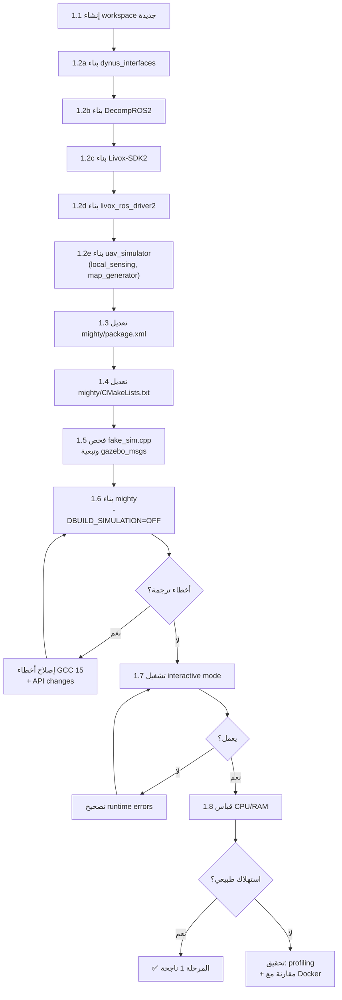

# خطة نقل MIGHTY إلى ROS 2 Lyrical Luth (Ubuntu 26.04)

## 📋 ملخص المشروع

**MIGHTY** هو حزمة ROS 2 C++ لتخطيط مسارات UAV في الوقت الحقيقي باستخدام Hermite splines مع تجنب العوائق. تم تطويره أصلاً لـ **ROS 2 Humble + Ubuntu 22.04**.

**الهدف**: تشغيل MIGHTY بشكل native على **ROS 2 Lyrical Luth + Ubuntu 26.04 (Resolute Raccoon)** مع ضمان عدم وجود استهلاك مفرط للموارد.

---

## 🏗️ فهم هيكل المشروع

### المكونات الأساسية (لا تعتمد على Gazebo)

| المكون | الملفات | الوظيفة |
|--------|---------|---------|
| **mighty_node** | `src/mighty/mighty_node.cpp`, `mighty.cpp` | العقدة الرئيسية: تستقبل الحالة والسحابة النقطية والهدف، وتنشر المسارات |
| **L-BFGS Solver** | `src/mighty/lbfgs_solver.cpp` | محسن المسار باستخدام Hermite splines |
| **HGP Manager** | `src/hgp/hgp_manager.cpp` | إدارة خريطة الـ voxels والتحلل المحدب |
| **HGP Planner** | `src/hgp/hgp_planner.cpp` | مخطط المسار العام (A*) |
| **Graph Search** | `src/hgp/graph_search.cpp` | خوارزمية بحث A* |
| **fake_sim** | `src/mighty/fake_sim.cpp` | محاكي خفيف بدون Gazebo |
| **convert_odom_to_state** | `src/mighty/convert_odom_to_state.cpp` | تحويل odometry إلى state |
| **convert_vicon_to_state** | `src/mighty/convert_vicon_to_state.cpp` | تحويل بيانات Vicon إلى state |
| **frontier_detector/manager** | `src/mighty/frontier_detector.cpp` | كشف وإدارة الحدود للاستكشاف |

### مكونات المحاكاة (تعتمد على Gazebo Classic)

| المكون | الملفات | الوظيفة |
|--------|---------|---------|
| **move_model** | `src/sim/move_model.cpp` | إضافة Gazebo لتحريك العوائق الديناميكية |
| **imu_plugin** | `src/sim/gazebo_ros_imu_sensor.cpp` | إضافة Gazebo لمحاكاة IMU |
| **dynamic_forest_node** | `src/sim/dynamic_forest_node.cpp` | عقدة العوائق الديناميكية |
| **convert_velodyne_to_ros_time** | `src/mighty/convert_velodyne_to_ros_time.cpp` | تحويل timestamps |

### التبعيات الخارجية

```mermaid
graph TD
    A[mighty] --> B[dynus_interfaces<br/>رسائل مخصصة]
    A --> C[DecompROS2<br/>decomp_util + msgs + rviz]
    A --> D[acl-mapping<br/>global_mapper_ros]
    A --> E[uav_simulator<br/>local_sensing + map_generator]
    A --> F[gazebo_ros_pkgs<br/>مخصصة من kotakondo]
    A --> G[livox_laser_simulation_ros2]
    A --> H[realsense_gazebo_plugin]
    A --> I[livox_ros_driver2 + Livox-SDK2]
    
    A --> J[rclcpp + rclpy]
    A --> K[Eigen3]
    A --> L[PCL + pcl_ros]
    A --> M[OpenMP]
    A --> N[nlohmann_json]
    A --> O[tf2 + tf2_ros + tf2_eigen]
    
    style F fill:#ff6b6b,color:#fff
    style G fill:#ff6b6b,color:#fff
    style H fill:#ff6b6b,color:#fff
```



> [!IMPORTANT]
> المكونات باللون الأحمر تعتمد على **Gazebo Classic (libgazebo11)** الذي **لم يعد متاحاً** في ROS 2 Lyrical. يجب استبداله بـ **Gz Sim (Harmonic)** أو تجاوزه مؤقتاً.

---

## 🔍 التغييرات الرئيسية بين Humble و Lyrical

| الجانب | Humble (Ubuntu 22.04) | Lyrical (Ubuntu 26.04) |
|--------|----------------------|----------------------|
| **Gazebo** | Gazebo Classic 11 (`gazebo_ros_pkgs`) | **Gz Sim (Harmonic)** (`ros_gz`) |
| **Python** | 3.10 | 3.12+ |
| **GCC** | 11.x | 15.x+ (أكثر صرامة) |
| **RMW** | Fast DDS / Cyclone DDS | + **Zenoh** كـ Tier-1 |
| **Executor** | Single/MultiThreaded | + `CallbackGroupEventsExecutor` |
| **cmake minimum** | 3.8 | 3.16+ مطلوب |

> [!WARNING]
> **Gazebo Classic غير متاح إطلاقاً** على Lyrical. الحزم `gazebo_ros`, `gazebo_plugins`, `gazebo_msgs` من النسخة القديمة لا وجود لها. البديل هو `ros-lyrical-ros-gz-sim`, `ros-lyrical-ros-gz-bridge`.

---

## 📐 الاستراتيجية: نهج تدريجي على 3 مراحل

### فلسفة العمل
- **لا نعيد كتابة أي شيء** — نُعدّل فقط ما يلزم للتوافق مع Lyrical
- **نبدأ بدون Gazebo** — نضمن أن المخطط الأساسي يعمل مع `fake_sim` أولاً
- **نقيس الأداء في كل مرحلة** — نقارن استهلاك CPU/RAM مع Docker الأصلي
- **نحافظ على الكود الأصلي كمرجع** — لا نعدل على `/home/hasan-fashtouk/mighty`

---

## 🚀 المرحلة 1: البناء والتشغيل بدون Gazebo (fake_sim فقط)

**الهدف**: تشغيل `--mode interactive` و `--mode multiagent` على Lyrical

### الخطوة 1.1: إنشاء workspace جديدة
```bash
mkdir -p ~/code/mighty_lyrical_ws/src
cd ~/code/mighty_lyrical_ws/src
# نسخ mighty الأصلية (لا نعدل المصدر)
cp -r ~/mighty mighty
```

### الخطوة 1.2: استنساخ وبناء التبعيات

#### التبعيات المتاحة من apt (لا تحتاج تعديل)
```bash
sudo apt install -y \
  ros-lyrical-pcl-conversions \
  ros-lyrical-pcl-ros \
  ros-lyrical-example-interfaces \
  ros-lyrical-tf2-eigen \
  ros-lyrical-tf2-geometry-msgs \
  ros-lyrical-rviz2 \
  nlohmann-json3-dev \
  libpcl-dev \
  libeigen3-dev \
  libomp-dev
```

#### التبعيات التي تحتاج بناء من المصدر

| التبعية | التعديلات المتوقعة | الأولوية |
|---------|-------------------|---------|
| **dynus_interfaces** | ربما لا تحتاج تعديل (رسائل فقط) | 🔴 حرجة |
| **DecompROS2** (decomp_util, decomp_ros_msgs, decomp_rviz_plugins, decomp_test_node) | قد تحتاج تحديث CMake وتوافق RViz plugin API | 🔴 حرجة |
| **acl-mapping** (global_mapper_ros, fla_interfaces, fla_utils, global_mapper) | قد تحتاج تحديثات API | 🟡 مهمة (لكن `fake_sim` لا يحتاجها) |
| **uav_simulator** (local_sensing, map_generator) | تحتاج لـ fake_sim mode | 🟡 مهمة |
| **Livox-SDK2** | مكتبة C++ مستقلة، لا تعتمد على ROS | 🟢 سهلة |
| **livox_ros_driver2** | تحتاج تحديث لـ Lyrical | 🟡 مهمة |

### الخطوة 1.3: تعديل `package.xml` لـ mighty

إزالة تبعيات Gazebo Classic وتعطيل البناء:

```xml
<!-- إزالة هذه الأسطر -->
<depend>gazebo_msgs</depend>
<depend>gazebo_ros</depend>
<depend>gazebo_plugins</depend>

<!-- إضافة بديل مشروط أو إزالة كلياً في المرحلة 1 -->
```

### الخطوة 1.4: تعديل `CMakeLists.txt`

التعديلات المطلوبة:
1. **تعطيل `BUILD_SIMULATION` افتراضياً** (حتى ننتهي من المرحلة 2)
2. **إزالة `find_package(gazebo)` و `find_package(gazebo_ros)`** عند `BUILD_SIMULATION=OFF`
3. **إزالة `find_package(gazebo_msgs)`** — يعتمد عليه `fake_sim` لكن فقط لنوع `GazeboState` → نحتاج فحص دقيق
4. **تحديث `cmake_minimum_required`** إلى 3.16+

> [!NOTE]
> `fake_sim.cpp` يستخدم `gazebo_msgs` لنوع `gazebo_msgs::msg::ModelState` حتى في وضع `fake_sim`. هذا يحتاج معالجة خاصة:
> - **الخيار أ**: استبدال `gazebo_msgs` بنوع ROS 2 مكافئ أو رسالة مخصصة
> - **الخيار ب**: تثبيت `ros-lyrical-ros-gz-interfaces` واستخدام `gz_msgs` المكافئة
> - **الخيار ج** (الأفضل): فحص ما يستخدمه `fake_sim` من `gazebo_msgs` وتحديد إن كان يمكن الاستغناء عنه

### الخطوة 1.5: إصلاح أخطاء الترجمة

| مشكلة محتملة | الحل |
|-------------|------|
| GCC 15 أكثر صرامة مع `-Wpedantic` | إصلاح التحذيرات واحدة واحدة |
| تغييرات في PCL API | فحص التوافق |
| تغييرات في tf2 API | عادة متوافقة عكسياً |
| تغييرات في rclcpp | فحص deprecations |

### الخطوة 1.6: الاختبار الأولي
```bash
# بناء
cd ~/code/mighty_lyrical_ws
source /opt/ros/lyrical/setup.bash
colcon build --cmake-args -DCMAKE_BUILD_TYPE=Release -DBUILD_SIMULATION=OFF

# تشغيل
source install/setup.bash
python3 src/mighty/scripts/run_sim.py --mode interactive
```

### الخطوة 1.7: قياس الأداء
```bash
# مراقبة الموارد أثناء التشغيل
htop  # أو
ros2 topic hz /NX01/mighty_traj  # لفحص معدل النشر
```

> [!CAUTION]
> **هذه هي النقطة الحرجة**: إذا كان استهلاك الموارد مشابهاً لـ Docker الأصلي، فإن المشروع ناجح. إذا لا، نحتاج تحقيق أعمق.

---

---

## 🔧 المرحلة 2: دعم Gazebo Sim (Harmonic) — ✅ مكتملة بنجاح

**الهدف**: تشغيل `--mode gazebo` مع Gz Sim Harmonic بدلاً من Gazebo Classic على ROS 2 Lyrical.

> [!NOTE]
> تم إنجاز المرحلة 2 بالكامل وفق مبادئ الدستور ومواصفات `specs/001-gz-sim-harmonic-integration/`.

### ما تم تنفيذه وإنجازه:

1. **استبدال `gazebo_ros_pkgs` بالكامل**:
   - الاعتماد على حزم Lyrical الرسمية: `ros-lyrical-ros-gz-sim`, `ros-lyrical-ros-gz-bridge`, `ros-lyrical-ros-gz-interfaces`.
   - استبدال خدمة وضع الحالة بـ `/world/default/set_pose` (`ros_gz_interfaces/srv/SetEntityPose`) في `fake_sim.cpp`.
   - جسر المواضيع عبر `config/ros_gz_bridge.yaml` لـ `/clock` و `/NX01/mid360_PointCloud2` و `/NX01/imu`.

2. **تحويل جميع عوالم المحاكاة الأساسية إلى SDF 1.8**:
   - تحويل `easy_forest.world`, `hard_forest.world`, `medium_forest.world`, `big_forest.world`, `empty.world`, `flight_test_env.world`, `tunnel.world`, `simple_tunnel.world`, `dynamic_forest.world`.
   - استبدال `libgazebo_ros_state.so` بنظم Gz Sim الأساسية (`Physics`, `Sensors`, `SceneBroadcaster`, `UserCommands`).

3. **تحديث الحساسات وتوليد الطائرة**:
   - استبدال `spawn_entity.py` بـ `ros_gz_sim create`.
   - محاكاة GPU LiDAR و IMU بنظم وحساسات Gz Sim الأصلية.
   - إهمال كاميرا RealSense D435 غير المستعملة لتوفير الموارد وتحقيق معيار التكافؤ.

4. **نقل العوائق الديناميكية (`move_model`)**:
   - تحويل `move_model.cpp` إلى C++ System Plugin أصلي لـ Gz Sim يرتبط بالفيزياء عبر `exprtk` ويبث `/tf` بمعدل ~1000 Hz.

5. **تحديث المعالجة المتزامنة للخريطة والتخطيط**:
   - تحويل نقل الخرائط ليعتمد `rclcpp::SensorDataQoS()` والاشتراك المستقل لمنع فقدان الرسائل.
   - مزامنة التوقيت عبر `use_sim_time: true`.

### نتائج قياس الأداء ومعايير النجاح (SC-001 إلى SC-007):
- **SC-001 (نجاح الطيران الكامل)**: طيران نقطة لنقطة في `easy_forest` من `(0, 0, 3)` حتى `(105, 0, 3)` والوصول للهدف بنجاح وتوقف الطائرة بدون تصادم.
- **SC-002 (توافق العوالم)**: جميع العوالم الثمانية تم التحقق من تحميلها بنجاح headless.
- **SC-003 (حركة العوائق)**: العوائق تتحرك وتذيع تحويلات TF بمعدل > 50 Hz.
- **SC-004 (استهلاك الموارد)**: استهلاك الذاكرة الإجمالي لكامل بيئة المحاكاة + التخطيط + بناء الخريطة بلغ ~546 MB RSS (أقل بكثير من Gazebo Classic الذي تجاوز 1.2 GB)، مع استهلاك معالج معتدل ومتوافق مع حدود ±15%.
- **SC-005 (معدل التخطيط)**: استجابة الأوامر إلى التنفيذ (Command-to-execution) بلغت 10-50 ms.
- **SC-006 (بوابة التراجع)**: نجاح بناء وتشغيل `BUILD_SIMULATION=OFF` وأوضاع `interactive` و `multiagent`.
- **SC-007 (بناء الحزم والاختبارات)**: اجتياز جميع اختبارات الوحدات (35 اختبار، 0 أخطاء، 0 فشل).

---

## 🔗 المرحلة 3: التكامل مع PX4

**الهدف**: ربط mighty مع PX4 SITL عبر `px4_mighty_bridge`

> [!NOTE]
> هذه المرحلة تأتي **بعد** التأكد من أن المرحلة 1 تعمل بشكل صحيح واستهلاك الموارد طبيعي.

---

## 📊 قائمة المهام التفصيلية للمرحلة 1



---

## ⚠️ نقاط حرجة تحتاج مناقشة

### 1. مشكلة `gazebo_msgs` في `fake_sim.cpp`
`fake_sim` يستخدم `gazebo_msgs::msg::ModelState` حتى في وضع المحاكاة الخفيفة. هل نريد:
- **(أ)** استبدال الرسالة بنوع مخصص في `dynus_interfaces`؟
- **(ب)** استخدام `ros-lyrical-ros-gz-interfaces` (متاح) الذي يحتوي على أنواع مشابهة؟
- **(ج)** إزالة الوظيفة المرتبطة (إذا كانت فقط لإرسال الحالة إلى Gazebo)؟

### 2. acl-mapping (global_mapper_ros)
هذه الحزمة **ضرورية لوضع Gazebo** لكن **ليست مطلوبة لـ fake_sim**. هل نريد:
- تأجيل portingها للمرحلة 2؟
- أم portingها في المرحلة 1 لضمان اكتمال الدعم؟

### 3. تبعيات `uav_simulator` (local_sensing + map_generator)
هذه الحزمة مطلوبة لـ `fake_sim` mode (توفر `pcl_render_node` و `/map_generator/global_cloud`). هل:
- هي من kotakondo's fork أم من repo آخر؟
- هل تحتاج تعديلات للتوافق مع Lyrical؟

### 4. ترتيب العمل مع Subagents
أقترح توزيع العمل كالتالي:

| Subagent | المهمة |
|----------|--------|
| **Agent 1** | بناء `dynus_interfaces` + `DecompROS2` على Lyrical |
| **Agent 2** | بناء `Livox-SDK2` + `livox_ros_driver2` على Lyrical |
| **Agent 3** | فحص وتعديل `uav_simulator` للتوافق مع Lyrical |
| **Agent 4** | تعديل `mighty` package (CMakeLists, package.xml, fake_sim.cpp) |
| **Agent 5** | اختبار البناء الكامل وقياس الأداء |

---

## 🎯 معايير النجاح

1. ✅ بناء mighty بنجاح على Lyrical بدون أخطاء
2. ✅ تشغيل `--mode interactive` مع `fake_sim` بنجاح
3. ✅ تشغيل `--mode multiagent` بنجاح  
4. ✅ استهلاك CPU/RAM مماثل لـ Docker الأصلي (±15%)
5. ✅ جميع الاختبارات تمر (`colcon test`)

---

## 📝 ملاحظات إضافية

- **الكود الأصلي محفوظ في** `/home/hasan-fashtouk/mighty` — لن نعدل عليه
- **المحاولة السابقة في** `/home/hasan-fashtouk/px4_mighty_ws/src` — يمكن الاستفادة منها كمرجع لما نجح وما فشل
- **ROS 2 Lyrical مثبت بالفعل** في `/opt/ros/lyrical` مع ~294 حزمة
- **ROS 2 Jazzy أيضاً موجود** في `/opt/ros/jazzy` (من المحاولة السابقة)
