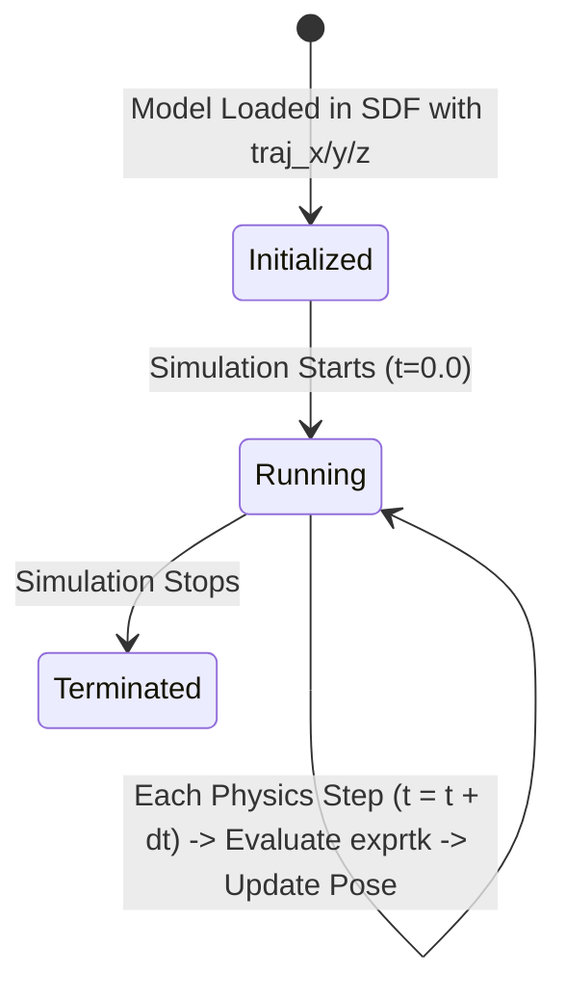

# Data Model: Gz Sim (Harmonic) Integration

This document defines the key entities, schema structures, parameters, and state representations used across the MIGHTY Gz Sim integration.

---

## 1. Simulation World Entity

### Description
Represents the 3D environment in which the UAV plans trajectories and encounters static and dynamic obstacles.

### Schema (SDF 1.8 / Gz Sim World)
```xml
<sdf version="1.8">
  <world name="default">
    <!-- Core Gz Sim World Systems -->
    <plugin filename="gz-sim-physics-system" name="gz::sim::systems::Physics"/>
    <plugin filename="gz-sim-sensors-system" name="gz::sim::systems::Sensors">
      <render_engine>ogre2</render_engine>
    </plugin>
    <plugin filename="gz-sim-scene-broadcaster-system" name="gz::sim::systems::SceneBroadcaster"/>
    <plugin filename="gz-sim-user-commands-system" name="gz::sim::systems::UserCommands"/>

    <!-- Physics Parameters -->
    <physics name="1ms" type="ignored">
      <max_step_size>0.001</max_step_size>
      <real_time_factor>1.0</real_time_factor>
    </physics>

    <!-- World Environment: Ground plane, lights, static obstacle models -->
    ...
  </world>
</sdf>
```

### Attributes & Rules
- **Name**: Must match the environment name passed via `--env` (defaults to `default` or world filename stem).
- **Physics Step**: `0.001s` (1000 Hz) for accurate raycasting and collision detection.
- **Render Engine**: `ogre2` for GPU sensor support (GPU LiDAR).

---

## 2. Dynamic Obstacle Entity (`ObstacleSpec`)

### Description
Parametric moving obstacles in the world whose positions evolve over simulation time `t` according to mathematical expressions.

### Data Fields
| Field | Type | Description | Validation Rule |
|-------|------|-------------|-----------------|
| `model_name` | `std::string` | Unique name of the obstacle model in Gz Sim | Non-empty, unique |
| `traj_x` | `std::string` | Parametric expression `x(t)` for x coordinate | Valid `exprtk` expression containing `t` |
| `traj_y` | `std::string` | Parametric expression `y(t)` for y coordinate | Valid `exprtk` expression containing `t` |
| `traj_z` | `std::string` | Parametric expression `z(t)` for z coordinate | Valid `exprtk` expression containing `t` |
| `t_var` | `double` | Current simulation time in seconds | Monotonically increasing, `t >= 0.0` |
| `bbox` | `std::array<double, 3>` | 3D bounding box dimensions `(dx, dy, dz)` | `dx, dy, dz > 0.0` |

### State Transitions


---

## 3. UAV Model & Sensor Entities

### Description
The simulated quadrotor platform carrying the GPU LiDAR sensor and receiving kinematic pose updates.

### Attributes
| Component | Type / Name | Parameters | Target ROS 2 Topic |
|-----------|-------------|------------|-------------------|
| **Base Link** | `base_link` | Geometry mesh: `quadrotor_base_2.dae` | `/{ns}/base_link` (TF) |
| **GPU LiDAR** | `<sensor type="gpu_lidar">` | Range: `0.1m - 30.0m`, 360° horizontal FOV, 30° vertical FOV, Update rate: `10-20 Hz` | `/{ns}/mid360_PointCloud2` |
| **IMU** | `<sensor type="imu">` | Update rate: `100 Hz`, Gaussian noise configured | `/{ns}/imu` |

---

## 4. State Representation (`dynus_interfaces/msg/State`)

### Description
Primary UAV state published by `fake_sim` and consumed by `mighty_node` and `global_mapper_ros`.

### Fields
| Field | Type | Description |
|-------|------|-------------|
| `header` | `std_msgs/Header` | Timestamp and `frame_id` (`map`) |
| `pos` | `geometry_msgs/Point` | 3D position `(x, y, z)` in world/map coordinates |
| `vel` | `geometry_msgs/Vector3` | 3D linear velocity `(vx, vy, vz)` |
| `accel` | `geometry_msgs/Vector3` | 3D linear acceleration `(ax, ay, az)` |
| `quat` | `geometry_msgs/Quaternion` | Orientation quaternion `(x, y, z, w)` derived via Hopf fibration |

---

## 5. Occupancy Grid Entities (from `global_mapper_ros`)

### Description
Voxel grids generated from GPU LiDAR data, published to ROS 2 topics for MIGHTY's planner.

### Fields
| Topic | Message Type | Description |
|-------|--------------|-------------|
| `/{ns}/occupancy_grid` | `sensor_msgs/msg/PointCloud2` | Points marked as occupied by obstacles |
| `/{ns}/unknown_grid` | `sensor_msgs/msg/PointCloud2` | Points representing unobserved/unknown space |
| `/{ns}/distance_grid` | `sensor_msgs/msg/PointCloud2` | ESDF distance field for trajectory safety cost |
