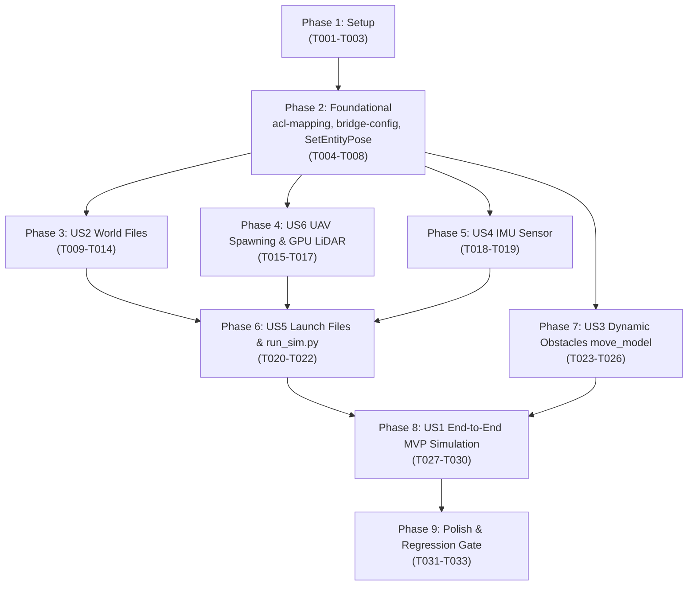

# Tasks: Gz Sim (Harmonic) Integration for MIGHTY

**Branch**: `001-gz-sim-harmonic-integration` | **Spec**: [spec.md](spec.md) | **Plan**: [plan.md](plan.md)

---

## Phase 1: Setup (Workspace & Dependency Infrastructure)

**Purpose**: Prepare the build environment, system packages, and core package metadata for Gz Sim Harmonic.

- [x] T001 Install Gz Sim simulation packages via `sudo apt update && sudo apt install -y ros-lyrical-ros-gz-sim ros-lyrical-ros-gz-bridge ros-lyrical-ros-gz-interfaces`
- [x] T002 Update dependencies in `mighty_lyrical_ws/src/mighty/package.xml` to replace `gazebo_ros`, `gazebo_plugins`, and `gazebo_msgs` with `ros_gz_sim`, `ros_gz_bridge`, and `ros_gz_interfaces`
- [x] T003 Update `mighty_lyrical_ws/src/mighty/CMakeLists.txt` to find `ros_gz_sim`, `ros_gz_bridge`, and `ros_gz_interfaces` under `if(BUILD_SIMULATION)` and enforce `cmake_minimum_required(VERSION 3.16)`

---

## Phase 2: Foundational (Blocking Prerequisites)

**Purpose**: Core mapping packages, bridge configuration, and pose-injection service clients required by all simulation modes.

**⚠️ CRITICAL**: Must be completed before running any full simulation user stories.

- [x] T004 Copy `acl-mapping` source tree from `mighty_ws/src/acl-mapping` to `mighty_lyrical_ws/src/acl-mapping`
- [x] T005 [P] Update CMakeLists.txt and package.xml in `mighty_lyrical_ws/src/acl-mapping/fla_utils`, `mighty_lyrical_ws/src/acl-mapping/global_mapper`, and `mighty_lyrical_ws/src/acl-mapping/global_mapper_ros` for GCC 15 and ROS 2 Lyrical compiler flags
- [x] T006 Build and verify `acl-mapping` packages using `colcon build --packages-up-to global_mapper_ros` in `mighty_lyrical_ws/`
- [x] T007 Update `sendGazeboState` in `mighty_lyrical_ws/src/mighty/src/mighty/fake_sim.cpp` to call `/world/default/set_pose` using `ros_gz_interfaces::srv::SetEntityPose` when `send_state_to_gazebo` is true
- [x] T008 [P] Create bridge configuration file in `mighty_lyrical_ws/src/mighty/config/ros_gz_bridge.yaml` defining `/clock`, `/NX01/mid360_PointCloud2`, and `/NX01/imu` mappings per `contracts/bridge-config.yaml`

**Checkpoint**: Foundation ready — simulator packages build and mapping dependencies are operational.

---

## Phase 3: User Story 2 - SDF World File Compatibility (Priority: P1)

**Goal**: Convert all 8 core simulation worlds from Gazebo Classic SDF to Gz Sim Harmonic SDF 1.8 with native system plugins.

**Independent Test**: Load each world headless via `gz sim -s -r <world_file>` and confirm physics and scene broadcaster initialize without errors.

- [x] T009 [P] [US2] Convert `easy_forest.world` in `mighty_lyrical_ws/src/mighty/worlds/easy_forest.world` to SDF 1.8 by adding Gz Sim systems (`Physics`, `Sensors`, `SceneBroadcaster`, `UserCommands`) and removing `libgazebo_ros_state.so`
- [x] T010 [P] [US2] Convert `hard_forest.world` in `mighty_lyrical_ws/src/mighty/worlds/hard_forest.world` to SDF 1.8 with Gz Sim systems
- [x] T011 [P] [US2] Convert `medium_forest.world` and `big_forest.world` in `mighty_lyrical_ws/src/mighty/worlds/` to SDF 1.8 with Gz Sim systems
- [x] T012 [P] [US2] Convert `empty.world` and `flight_test_env.world` in `mighty_lyrical_ws/src/mighty/worlds/` to SDF 1.8 with Gz Sim systems
- [x] T013 [P] [US2] Convert `tunnel.world` and `simple_tunnel.world` in `mighty_lyrical_ws/src/mighty/worlds/` to SDF 1.8 with Gz Sim systems
- [x] T014 [US2] Verify headless simulation execution of all 8 converted world files using `gz sim -s -r` in `mighty_lyrical_ws/src/mighty/worlds/`

**Checkpoint**: All 8 core simulation environments load cleanly in Gz Sim Harmonic.

---

## Phase 4: User Story 6 - UAV Spawning & Sensor Configuration in Gz Sim (Priority: P2)

**Goal**: Spawn the UAV model in Gz Sim using `ros_gz_sim create` with native GPU LiDAR active and D435 camera omitted.

**Independent Test**: Spawn the UAV into `empty.world` and verify `ros2 topic echo /NX01/mid360_PointCloud2` receives valid `sensor_msgs/msg/PointCloud2` messages.

- [x] T015 [US6] Update `quadrotor.urdf.xacro` in `mighty_lyrical_ws/src/mighty/urdf/quadrotor.urdf.xacro` to declare Gz native `<sensor name="gpu_lidar" type="gpu_lidar">` on topic `/NX01/lidar/points` and remove `librealsense_gazebo_plugin.so`
- [x] T016 [US6] Replace `spawn_entity.py` invocation in `mighty_lyrical_ws/src/mighty/launch/onboard_mighty.launch.py` with `ros2 run ros_gz_sim create -topic robot_description -name NX01`
- [x] T017 [US6] Verify UAV spawning and point cloud publication at ≥ 10 Hz on `/NX01/mid360_PointCloud2` using `ros_gz_bridge` in `mighty_lyrical_ws/`

**Checkpoint**: UAV spawns in Gz Sim and broadcasts LiDAR point clouds to ROS 2.

---

## Phase 5: User Story 4 - IMU Sensor Plugin Replacement (Priority: P2)

**Goal**: Replace custom Gazebo Classic IMU plugin with Gz Sim native IMU sensor and bridge to ROS 2.

**Independent Test**: Echo `/NX01/imu` during simulation and verify valid `sensor_msgs/msg/Imu` data at ≥ 100 Hz.

- [x] T018 [US4] Configure Gz Sim native `<sensor name="imu" type="imu">` in `mighty_lyrical_ws/src/mighty/urdf/quadrotor.urdf.xacro` publishing to `/NX01/imu`
- [x] T019 [US4] Verify IMU topic bridge routing in `mighty_lyrical_ws/src/mighty/config/ros_gz_bridge.yaml` and validate rate on `/NX01/imu` at ≥ 100 Hz

**Checkpoint**: IMU data streams continuously to ROS 2.

---

## Phase 6: User Story 5 - Launch File and run_sim.py Adaptation (Priority: P1)

**Goal**: Update launch orchestration scripts so `run_sim.py --mode gazebo` starts Gz Sim seamlessly.

**Independent Test**: Execute `python3 run_sim.py --mode gazebo --env easy_forest --dry-run` and verify correct node commands and arguments.

- [x] T020 [US5] Update `base_mighty.launch.py` in `mighty_lyrical_ws/src/mighty/launch/base_mighty.launch.py` to replace `gazebo_ros/gazebo.launch.py` with `ros_gz_sim/gz_sim.launch.py` and start `ros_gz_bridge` with `config/ros_gz_bridge.yaml`
- [x] T021 [US5] Update `onboard_mighty.launch.py` in `mighty_lyrical_ws/src/mighty/launch/onboard_mighty.launch.py` to ensure `robot_state_publisher` and `fake_sim` are launched correctly for `sim_env:=gazebo`
- [x] T022 [US5] Update `generate_gazebo_yaml` in `mighty_lyrical_ws/src/mighty/scripts/run_sim.py` to remove `source /usr/share/gazebo/setup.bash` and launch the updated base station stack

**Checkpoint**: Launch infrastructure orchestrates Gz Sim and ROS 2 nodes cleanly via CLI.

---

## Phase 7: User Story 3 - Dynamic Obstacle Plugin Migration (Priority: P2)

**Goal**: Port `move_model` to a native Gz Sim C++ System Plugin for physics-synchronized moving obstacles with `exprtk`.

**Independent Test**: Launch a world with dynamic obstacles and verify obstacle models move along their parametric trajectories and broadcast `/tf`.

- [x] T023 [US3] Implement Gz Sim C++ System Plugin `move_model` (`gz::sim::System`, implementing `ISystemConfigure` and `ISystemPreUpdate`) with `exprtk` in `mighty_lyrical_ws/src/mighty/src/sim/move_model.cpp`
- [x] T024 [US3] Update `mighty_lyrical_ws/src/mighty/CMakeLists.txt` to compile `move_model` as a Gz Sim shared system plugin linked against `gz-sim::core` and `exprtk`
- [x] T025 [US3] Update `dynamic_forest_node.cpp` in `mighty_lyrical_ws/src/mighty/src/sim/dynamic_forest_node.cpp` to publish `dynus_interfaces/msg/DynTraj` without `gazebo_msgs`
- [x] T026 [US3] Verify dynamic obstacle motion in `dynamic_forest.world` and TF broadcasting at ≥ 50 Hz in `mighty_lyrical_ws/`

**Checkpoint**: Dynamic obstacles move and broadcast transforms within Gz Sim.

---

## Phase 8: User Story 1 - Single-Agent Gazebo Simulation on Lyrical (Priority: P1) 🎯 MVP

**Goal**: Full end-to-end integration: MIGHTY plans and executes collision-free trajectories in Gz Sim on ROS 2 Lyrical.

**Independent Test**: Run `python3 src/mighty/scripts/run_sim.py --mode gazebo --env easy_forest` and verify UAV reaches the goal without collisions.

- [x] T027 [US1] Build entire workspace with `colcon build --cmake-args -DCMAKE_BUILD_TYPE=Release -DBUILD_SIMULATION=ON` in `mighty_lyrical_ws/`
- [x] T028 [US1] Execute single-agent simulation test using `python3 src/mighty/scripts/run_sim.py --mode gazebo --env easy_forest` and verify goal arrival in `mighty_lyrical_ws/`
- [x] T029 [US1] Measure trajectory publication frequency on `/NX01/mighty_traj` via `ros2 topic hz` (verify rate ≥ 90% of Docker baseline)
- [x] T030 [US1] Measure CPU and RAM consumption via `htop` and verify resource parity within ±15% of Docker baseline per SC-004

**Checkpoint**: Full single-agent Gazebo simulation works natively on Lyrical with verified performance.

---

## Phase 9: Polish & Cross-Cutting Concerns

**Purpose**: Regression testing, test suite validation, and documentation updates.

- [x] T031 [P] Verify regression gate: build with `BUILD_SIMULATION=OFF` and confirm `run_sim.py --mode interactive` and `run_sim.py --mode multiagent` operate without error
- [x] T032 [P] Run `colcon test` across `mighty` and `acl-mapping` packages in `mighty_lyrical_ws/` and ensure zero failures
- [x] T033 Update `mighty-porting-plan.md` to document Phase 2 completion, updated package structure, and resource benchmark results

---

## Dependencies & Execution Order



---

## Parallel Execution Opportunities

### Phase 1 & 2 Parallel Tasks
```bash
# Update acl-mapping packages concurrently:
Task: T005 Update CMakeLists.txt and package.xml in fla_utils, global_mapper, and global_mapper_ros
Task: T008 Create bridge configuration file in config/ros_gz_bridge.yaml
```

### Phase 3 World Conversion Parallel Tasks
```bash
# Convert independent world files concurrently:
Task: T009 Convert easy_forest.world
Task: T010 Convert hard_forest.world
Task: T011 Convert medium_forest.world and big_forest.world
Task: T012 Convert empty.world and flight_test_env.world
Task: T013 Convert tunnel.world and simple_tunnel.world
```

### Phase 9 Polish Parallel Tasks
```bash
# Run regression tests and unit test suites concurrently:
Task: T031 Verify regression gate (fake_sim interactive and multiagent)
Task: T032 Run colcon test across all packages
```

---

## Implementation Strategy

### MVP Milestone (Phases 1 → 6 → 8)
1. Complete **Setup** (T001–T003) & **Foundational** (T004–T008).
2. Complete **US2 World Files** for `easy_forest.world` (T009).
3. Complete **US6 UAV Spawning & GPU LiDAR** (T015–T017).
4. Complete **US5 Launch Files** (T020–T022).
5. Run **US1 MVP Test** (T027–T028) in static `easy_forest` world.

### Full Delivery Milestone (Phases 3, 5, 7, 9)
1. Complete remaining world conversions (T010–T014).
2. Complete IMU replacement (T018–T019).
3. Complete `move_model` dynamic obstacle system plugin (T023–T026).
4. Run resource benchmarks (T029–T030) and regression gates (T031–T033).
